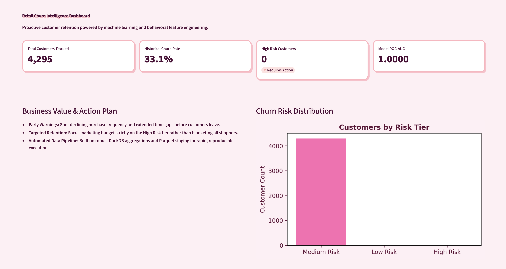

# Commerciometrics
Catch cusomers that are slipping away.

Customers come and go, but every once in a while, regular buyers just quietly stop showing up. By the time you notice they're gone, it's already too late to win them back.

Retailers have mountains of raw transaction logs, but turning that messy data into actual insights—like figuring out who's about to churn—is a massive headache. Raw files come in weird formats, data gets corrupted, and building features like customer tenure or how long someone waits between purchases takes a ton of heavy lifting.

Can we predict if we are going to lose a customer?

---

<p align="center">
  
</p>


### Key Behavioral Trends Tracked
To identify customers who are quietly slipping away, the feature engineering pipeline extracts key behavioral indicators:
* **Recency:** Measures the time gap since a customer's last purchase against their historical purchasing rhythm.
* **Frequency:** Tracks how often a customer buys over time to detect breakdowns in shopping routines.
* **Monetary Value:** Analyzes total spend and basket size to catch "shrinking baskets" where customers shift their primary business elsewhere.
* **Tenure & Latency:** Captures customer lifecycle duration and average time gaps between consecutive transactions.

---

### Pipeline Flow: Input, Processing & Output

1. **Input (Raw Staging):**
   * Massive, raw transactional logs containing timestamped line items, product codes, quantities, unit prices, and customer loyalty IDs.
2. **Processing (DuckDB & Parquet ETL):**
   * **Cleaning:** Filters out canceled orders, missing customer identifiers, and pricing anomalies.
   * **Transformation:** Leverages SQL and window functions via DuckDB to aggregate customer behavioral features.
   * **Storage:** Persists validated data into highly compressed, columnar **Parquet** files for lightning-fast execution and reproducible state management.
3. **Output (Modeling & Interface):**
   * **Machine Learning:** Trains optimized classifiers with class-imbalance adjustments (`scale_pos_weight`) tracked via **MLflow**.
   * **Decision Delivery:** Serves predictions through a custom, interactive **Streamlit dashboard** that flags high-risk customers and provides automated retention action recommendations.

---

### Tech Stack & Architecture Highlights

* **DuckDB:** Analytical database engine used to run high-speed SQL queries directly on local data files without requiring a heavy server infrastructure.
* **Parquet:** Columnar storage format with Snappy compression that optimizes read speeds and preserves rigid data types.
* **MLflow:** Experiment tracking framework used to log parameters, metrics (PR-AUC, F1, ROC-AUC), and serialized model artifacts.
* **LightGBM:** High-performance gradient-boosted decision tree framework optimized for tabular retail classification and handling class imbalance.

## Project Structure

```text
Commerciometrics/
├── data/
│   ├── raw/                      # Raw input datasets (e.g., Online Retail II)
│   └── processed/                # Intermediate tables & feature store outputs
│       ├── retail.duckdb         # Local analytical DuckDB database instance
│       ├── clean_transactions.parquet # Staging layer for cleaned commercial data
│       └── customer_features.parquet  # Official version-controlled feature store
├── outputs/                      # Generated analytical plots and figures
├── scripts/                      # Modular pipeline execution scripts
│   ├── ingest_and_clean.py       # Robust raw data ingestion and schema cleaning
│   ├── compute_recency.py        # Customer recency feature calculation
│   ├── compute_frequency.py      # Customer frequency feature calculation
│   ├── compute_monetary.py       # Customer monetary value calculation
│   ├── aggregate_rfm.py          # Unified RFM feature table aggregation
│   ├── compute_tenure.py         # Customer tenure feature calculation
│   ├── compute_latency.py        # Purchase latency and variance calculation
│   ├── compute_diversity.py      # Unique stock code / product diversity calculation
│   ├── aggregate_behavioral.py   # Unified behavioral feature table aggregation
│   ├── compute_churn.py          # Baseline 90-day churn target labeling
│   ├── build_feature_matrix.py   # Master feature matrix builder and joiner
│   ├── export_features.py        # Compressed Snappy Parquet feature store export
│   └── generate_plots.py         # Automated Pareto and visualization runner
├── tests/                        # Comprehensive unit and integration test suite
│   
├── run_pipeline.sh               # Automated pipeline shell orchestrator
├── requirements.txt              # Project dependencies
└── README.md                     # Project documentation
```

## Quickstart 

### 1. Install Dependencies
```bash
pip install -r requirements.txt
```

### 2. Run the pipeline 
```bash
cntrl +x run_pipeline.sh
./run_pipeline.sh
```


